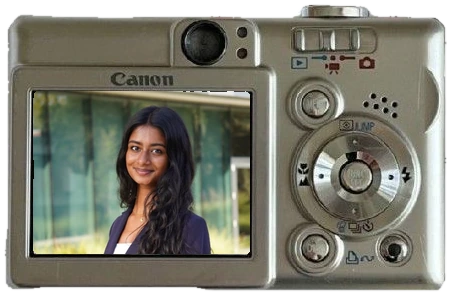

# Shreya Rajaram — Portfolio

A static, no-build portfolio site: iridescent mosaic tiles in the background, collage stickers scattered around (they're draggable).

## Run it
Open `index.html` in a browser — or serve the folder: `python -m http.server` → http://localhost:8000

## Edit content
Everything lives in `index.html`; look for `<!-- TODO -->` comments:
- **Hero tagline**, **About** text, skill chips, and city in the postmark
- **Projects** — copy an `<article class="stamp">` block per project (`--accent` picks the colour)
- **Experience** — copy an `<li class="ticket">` block per role
- **Resume** — drop your PDF at `assets/resume.pdf`
- **Contact** — email / LinkedIn / GitHub links

## Stickers
Cut-outs are in `assets/stickers/`. To place one, add:
```html

```
inside any section. `--x/--y` position it, `--w` sets the width, `--r` the tilt. Add `data-hide-mobile` to hide it on small screens.

## Deploy
Push to GitHub, then Settings → Pages → deploy from `main` / root.
